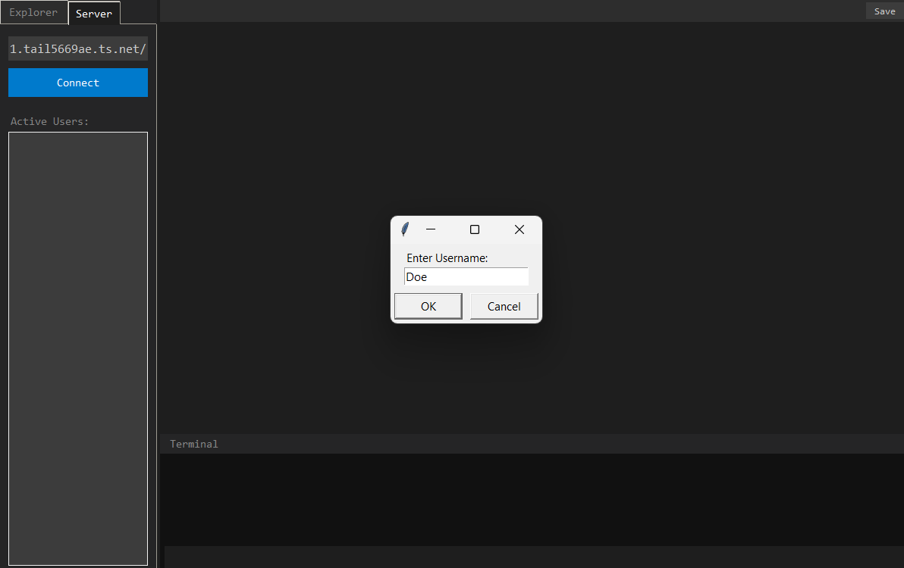
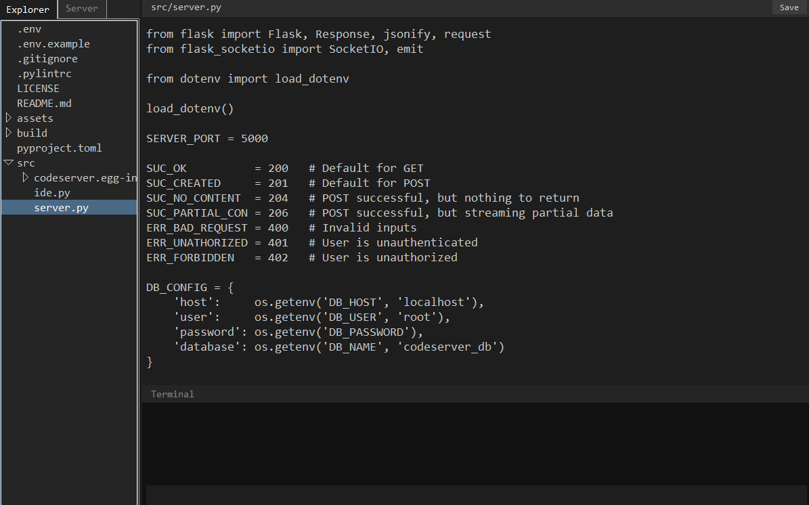

<p align="center">
    <picture>
        <source media="(prefers-color-scheme: dark)" srcset="assets/banner/dark.png">
        <source media="(prefers-color-scheme: light)" srcset="assets/banner/light.png">
        
    </picture>
</p>

*This project is a submission for the CBSE Class 12 Computer Science project by Faris Muhammad, Pavithra Muthukumar, and Mrinalika Rajan.*

A Flask backend to host a given project folder, connected to WAN via tailscale, allowing clients to then be able to connect by an IDE, designed in Tkinter, to access the files, folders, read files, write files, create directories, etc., as if the server folder were on the client's computer.

Each client is treated as a "user" stored inside a MySQL database. Changes by one user are reflected to other users on the same project connection. Changes are also buffered into a MySQL table mapping the file changed and the changes made (keystrokes at given row and column).

When a client opens the file, the server returns the change buffer of that file. If a client saves the file, the buffer is cleared. The buffer cannot be entirely stored in RAM, since RAM is non-persistent. Changes can be stored on the client side, but it is impractical to do so. If the server goes down, the RAM goes, and data is lost. To minimize this, the data must be stored in a persistent manner, which MySQL provides.

Refer [DOCS.md](./DOCS.md) for more information on the functionings.

<table>
    <tr>
        <td align="center">
            <br>
            <sub><b>Figure 1:</b> Connecting to a server</sub>
        </td>
        <td align="center">
            <br>
            <sub><b>Figure 2:</b> Accessing a file (server.py)</sub>
        </td>
    </tr>
</table>

# Setup

```bash
git clone https://github.com/farismuhammad17/CodeServer.py
cd CodeServer.py
pip install .
```

## Starting the server

The following command will start up the server and request for the project directory if one is not provided in the path. The program also automatically starts up tailscale, unless the `--no-tailscale` argument is passed.

```bash
python src/server.py <optional path> <optional --no-tailscale>
```

## Using the IDE

Once the server URL is provided, it functions as a standard IDE on the client computer for a folder on the server computer.

```bash
python src/ide.py
```

# Todo

* Use the IDE terminal as client-server logs for communication ease.
    * Connection phase
    * User joining/leaving
    * etc.
* A password request when connecting to a server. Also requires that the server password be put inside the `.env` file.

# Acknowledgments

*To be filled later*

---

*This project is licensed under the Apache 2.0 license. See [LICENSE](./LICENSE) for more information.*
